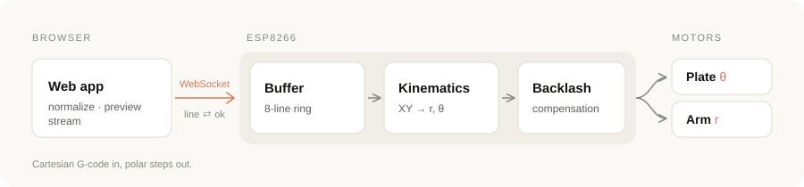
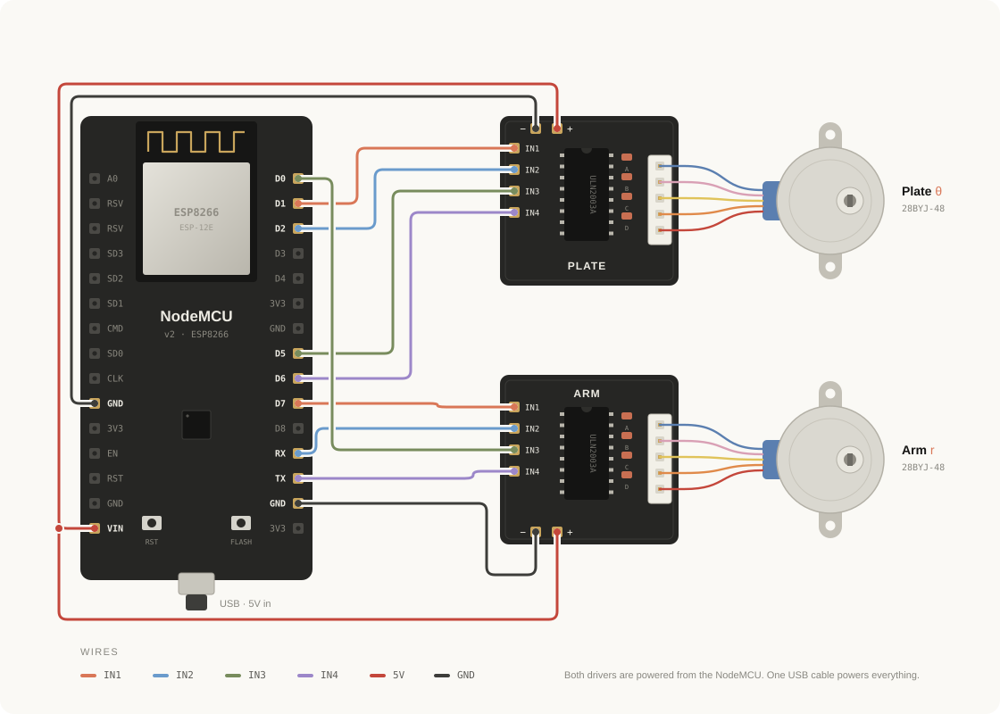

# PolarBot

A low-cost, WiFi-controlled **polar plotter**. It draws on a rotating build plate using two 28BYJ-48 stepper motors and an ESP8266. You can stream G-code to it from a browser.

Most plotters move a pen along X and Y. PolarBot rotates the paper (θ) and moves the pen along a linear arm (r). The firmware converts Cartesian G-code into polar motion in real time.


---

## Features

- **Cartesian → polar kinematics.** Standard `G0`/`G1` moves are converted to plate and arm steps, with angle unwrapping so the plate never spins the long way round.
- **Straight lines.** Each move is split into 0.2 mm segments, so straight lines stay straight instead of curving into arcs.
- **Backlash compensation.** Direction reversals add a gap-closing move for each axis. You can tune it live over WiFi without reflashing.
- **Wireless streaming.** G-code is sent over a WebSocket with an `ok`-based handshake, so the ESP8266's small buffer never overflows.
- **No IP lookup needed.** WiFiManager provides a setup portal for your WiFi, and mDNS makes the plotter reachable at `polarplotter.local`.
- **Browser control panel.** A single static page with a G-code preview, progress bar, built-in test shapes, calibration and a console. It needs no build step and no server.

## Repository structure

```
PolarBot/
├── firmware/      ESP8266 firmware (PlatformIO project)
│   ├── platformio.ini
│   └── src/main.cpp
├── web/           Browser control panel (open index.html)
├── cad/           3D-printable parts (STL)
├── docs/          Architecture notes and diagrams
└── LICENSE
```

## How it works

<p align="center">
  
</p>

For a full walkthrough of the firmware, kinematics, buffering and the hardware issues solved along the way, see [`docs/ARCHITECTURE.md`](docs/ARCHITECTURE.md).

---

## Hardware

### Bill of materials

| Qty | Part | Notes |
|:---:|------|-------|
| 1 | NodeMCU v2 (ESP8266) | Microcontroller + WiFi |
| 2 | 28BYJ-48 stepper motor (5 V) | One rotates the plate, one drives the arm |
| 2 | ULN2003 driver board | One per motor, powered from the NodeMCU |
| 1 | USB cable | The only power source for the whole machine |
| 1 | Pen | Held by the printed pen holder |
| — | Printed parts | See [`cad/`](cad) |

### Printed parts

| File | Description |
|------|-------------|
| `base_plate.stl` | Main machine base that the motors and rail mount on |
| `build_plate.stl` | Rotating Ø150 mm plate that carries the paper |
| `paper_clamp.stl` | Thin ring that holds the paper on the build plate |
| `base_gear.stl` | Gear that drives the build plate |
| `linear_rail.stl` | Linear rail for the pen arm |
| `linear_cap.stl` | Cap that closes the linear rail assembly |
| `linear_gear.stl` | Gear that drives the pen arm along the rail |
| `pen_holder_body.stl` | Pen holder body |
| `pen_holder_cap.stl` | Pen holder cap |

### Wiring

<p align="center">
  
</p>

| Driver input | Plate (θ) | Arm (r) |
|:------------:|:---------:|:-------:|
| IN1 | D1 · GPIO5 | D7 · GPIO13 |
| IN2 | D2 · GPIO4 | RX · GPIO3 |
| IN3 | D5 · GPIO14 | D0 · GPIO16 |
| IN4 | D6 · GPIO12 | TX · GPIO1 |
| − / + | GND / VIN | GND / VIN |

Both motors run in AccelStepper `HALF4WIRE` mode (4096 steps/rev). In the firmware, pins are passed in the order `IN1, IN3, IN2, IN4`, which is the correct coil sequence for the 28BYJ-48.

> [!NOTE]
> **Power:** both ULN2003 boards take their 5 V and GND straight from the NodeMCU, so the whole machine runs from a single USB port. The firmware homes the arm *before* turning on WiFi, so the motors and the radio never draw peak current at the same time.

> [!NOTE]
> The arm motor uses the TX/RX pins, so the firmware does **not** use `Serial`. All communication goes over WiFi. Disconnect the arm driver when flashing over USB if the upload fails.

---

## Getting started

### 1. Flash the firmware

Install [PlatformIO](https://platformio.org/) (CLI or the VS Code extension), then:

```bash
cd firmware
pio run --target upload
```

Library dependencies (AccelStepper, WebSockets, WiFiManager) are installed automatically.

### 2. Connect to WiFi

On first boot, the arm homes itself. The board then opens a WiFi access point called **`PolarPlotter-Setup`**:

1. Connect to it from a phone or laptop. A setup portal should open; if it doesn't, go to `http://192.168.4.1`.
2. Pick your home network and enter the password.
3. The board saves the credentials and joins your network on every boot from then on.

### 3. Open the control panel

Open [`web/index.html`](web/index.html) in a browser on the same network and click **Connect**. The default address is `ws://polarplotter.local:81`. If mDNS doesn't resolve on your network, replace the hostname with the board's IP address.

A hosted copy runs at **[yigitsalihemecen.github.io/PolarBot](https://yigitsalihemecen.github.io/PolarBot/)**. It previews G-code and test shapes, but it can't drive the plotter (see [Limitations](#limitations)).

### 4. Plot

1. Put the pen at the centre of the plate, or click **Home arm**.
2. Try a **Quick shape**, or load a `.gcode` file in the **Stream** tab.
3. Check the preview (125 mm diameter) and click **Start streaming**.

---

## G-code support

| Command | Meaning |
|---------|---------|
| `G0` / `G1 X Y` | Move to X, Y in mm (origin = plate centre) |
| `G90` / `G91` | Absolute / relative positioning |
| `G28` | Return to origin |
| `M100 P<steps> A<steps>` | Set plate / arm backlash compensation (custom) |
| `M101` | Home the arm (custom) |

`Z` values and feed rates are ignored. The firmware has no pen-lift axis, so the pen stays down during `G0` travel moves too. The preview shows these travel moves as dashed orange lines.

Before streaming, the web app converts every file to absolute `G0`/`G1` moves: it resolves `G91` relative moves and `G28`, and drops lines the firmware would ignore. It also merges moves shorter than 0.5 mm, which keeps dense files (for example SVG exports) from stuttering.

## Calibration

The motors' internal gearboxes have backlash. To compensate:

1. Click **Draw calibration test** in the Start tab. It draws a 40 × 40 mm square with a crosshair.
2. Measure the square. Enter the shortfall as the **Arm** backlash (mm).
3. If the crosshair or the corners are misaligned, adjust the **Plate** backlash (degrees) in steps of about 0.5°.
4. Click **Send to plotter** and repeat until the square is accurate.

Steps-per-revolution and steps-per-mm are constants at the top of [`firmware/src/main.cpp`](firmware/src/main.cpp) (`PLATE_STEPS_PER_REV`, `STEPS_PER_MM_ARM`).

---

## Limitations

- **No pen lift.** The pen touches the paper at all times, so every `G0` travel move leaves a line. Designs work best as one continuous path, or as strokes that start and end near each other.
- **Open-loop homing.** There is no endstop. Homing drives the arm into its mechanical stop for a fixed time and treats that as the centre. Accuracy depends on the pen being mounted consistently.
- **Backlash resets on reboot.** Values set with `M100` are not saved. The firmware starts with its built-in defaults every time it powers on.
- **Firmware `G91` / `G28` handling.** The firmware applies relative moves incorrectly, and `G28` doesn't move the pen. The web app converts these to absolute moves, so this only matters if you send G-code another way.
- **Web app runs locally.** Browsers block unencrypted WebSocket connections from HTTPS pages, so the [hosted copy](https://yigitsalihemecen.github.io/PolarBot/) on GitHub Pages can only preview. To plot, open `web/index.html` from disk.
- **No position feedback.** The 28BYJ-48 motors can skip steps under load without the firmware noticing.

## Roadmap

- [ ] Servo-driven pen lift (`M3`/`M5` or `Z` moves)
- [ ] Fix `G91` relative moves and `G28` in the firmware
- [ ] Save backlash settings to flash
- [ ] Serve the web app from the ESP8266 itself (`http://polarplotter.local`)
- [ ] Endstop or hall sensor for repeatable homing
- [ ] Built-in SVG → G-code conversion in the web app

## License

Released under the [MIT License](LICENSE).
